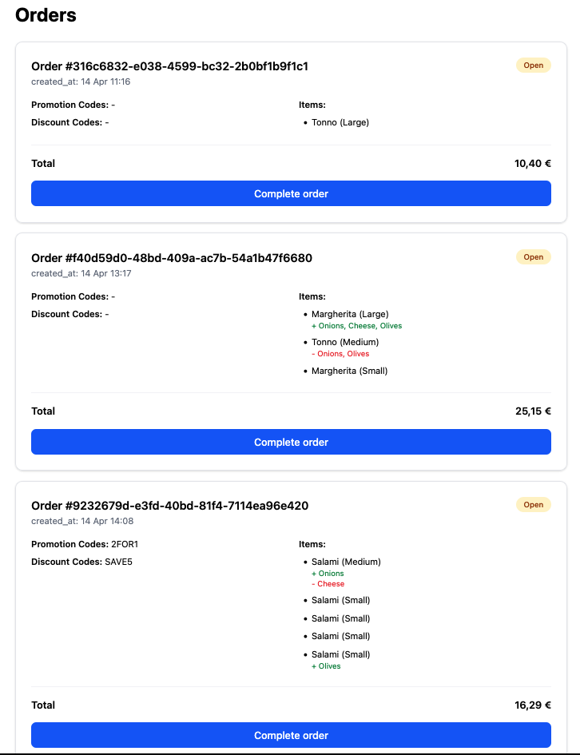

[](https://github.com/jethroo/rails-pizza-challenge/actions/workflows/ci.yml)

# Acture Group Rails Coding Challenge

We are excited that you are interested in performing our coding challenge. The purpose of this assignment is to see how you approach problems and evaluate the quality of your code.

## The task and requirements

This challenge is about implementing a simple pizza order overview for a restaurant. All orders need to be listed, with the items they contain, their details and the total price. In addition, it is possible to mark orders as completed.

For this purpose, a small full-stack application is to be created with Ruby on Rails, which provides the backend and a web UI to manage the orders. The UI should look like this:


In [`data/orders.json`](data/orders.json) you will find a sample listing that you can use as a basis for your listing. Use it to fill the corresponding fields in the UI.

Furthermore, to mark orders as completed, you can click on the respective button. It should send a `PATCH` request to a `/orders/:id` backend endpoint to update the order. Completed orders should then simply no longer be displayed in the UI.

At last, the total price for a pizza order is to be calculated and displayed. For a pizza order several pizzas can be ordered, per pizza the desired size and also special requests (extra ingredients and omit ingredients) can be specified. In addition, there is a possibility to reduce the price of the order by using various discount codes.

- The price of a pizza depends on the size. Per size there is a "multiplier" that is multiplied by the base price of the pizza.
- Extra ingredients are also provided with this multiplier.
- Ingredients that are omitted during preparation do not change the price of the pizza.
- Promotion codes allow getting pizzas for free; e.g., two small salami pizzas for the price of one. Extra ingredients will still be charged though. Multiple promotion codes can be specified per order. A promotion code can also be applied more than once to the same order (a 2-for-1 code automatically reduces 4 pizzas to 2 for one order).
- A discount code reduces the total invoice amount by a percentage.

In [`data/config.yml`](data/config.yml) you can find the list of selectable pizzas, the multipliers and ingredients, as well as the promotion and discount codes.


## How to proceed and submit the solution
- Arrange your time as you like. We are interested in you finding a solution you are happy with, not speed. But please do not spend more than 4 hours. 
- Create a private repository and checkout a feature branch.
- Push your solution and work with git like you would on a real project.
- Open a pull request when you are ready.
- Add us to the repository and mention us in the pull request, so we can take a look at your solution.
- Feel free to contact us at any time by mail with questions or difficulties.


## What we are looking for
- Does your solution work technically correct and is executable? Did you follow the instructions?
- Is your code well written and easy to read and understand? Did you use a linter?
- Are you following the usual conventions for Ruby on Rails development?
- How good are you at writing tests? And how easy are they to read and understand?
- How well is your solution documented? Are all steps for installation and execution described?
- How proficient are you in using git?


## Coding Challenge Comments by Carsten

### Running the dockerized rails 8 app

Starting the containers:
```bash
docker compose up -d
```
The app will be served on [localhost](http://localhost:3000/)

Setting up the database(s):
```bash
docker compose exec web rake db:setup
```

Running migrations:
```bash
docker compose exec web rake db:migrate
```

Running migrations:
```bash
docker compose exec web rake db:seed
```

Running the console
```bash
docker compose exec web bin/rails c
```

### Running the app without docker


Starting the server via binstub 
```bash
bin/dev
```

directly via
```bash
bundle exec rails s
```

Ensure postgres is running with corresponding user see [configuration](config/database.yml#L7) and database are present, migrated and seeded:

```bash
bundle exec rake db:setup
bundle exec rake db:migrate
bundle exec rake db:seed
```


### Datamodel

To start with, I decided to introduce only two models: Order and OrderItem. The latter represents pizza items, but I wanted to keep it a bit more generic since an order might also contain drinks, cookies, etc. in the future. While I could already introduce a polymorphic association to support this, I opted against it since this is currently just an assumption and not something explicitly required by the task.

For discounts and promotions, I considered introducing a separate model but decided against that as well, since they can be handled through the provided configuration for now. There is currently no use case that would justify introducing an additional model.

Regarding the Order state attribute, I decided to infer it from the object's existing attributes. If completed_at is not set, the order is considered OPEN. Once completed_at is set, the order is considered COMPLETED.

Introducing a separate database column for the state could lead to inconsistencies. For example, completed_at could be set while the state still indicates OPEN.

## Price Calculations

Since `BigDecimal` is preferred over `Float` for financial calculations due to its predictable decimal arithmetic and lack of floating-point precision errors, I decided to use it consistently throughout the pricing calculations.

I moved the provided `config.yml` to `./config/order_config.yml` so I could load the configuration directly through Rails using `config_for(:order_config)`. All prices defined in the configuration are converted to `BigDecimal` accordingly.

For calculating order prices, I identified three main responsibilities:

- **`OrderItem`**: Loads the required ingredient prices, pizza prices, and size multipliers to calculate its own price.
- **`Order`**: Loads the applicable promotions and discount codes needed to calculate the order total.
- **`OrderPricingService`**: Uses the methods provided by `OrderItem` and `Order` to calculate the total item price, apply promotions, and finally apply any discount.

#### Order Pricing Components

The pricing service does not modify previously generated price components. Instead, it adds separate components with negative amounts to represent promotions and discounts.

| Name | Amount (€) | Size | Extras (€) |
|---|---:|---|---:|
| Salami | 7.00 | medium | 1.00 |
| Salami | 4.20 | small | 0.00 |
| Salami | 4.20 | small | 0.00 |
| Salami | 4.20 | small | 0.00 |
| Salami | 5.95 | small | 1.75 |
| Salami (Promotion) | -4.20 | small | 0.00 |
| Salami (Promotion) | -4.20 | small | 0.00 |
| Discount | -0.8575 | — | 0.00 |
| **Total (rounded)** | **16.29** | | |

The implementation would need some adjustments if tax calculations were involved, particularly regarding rounding rules and when rounding should be applied.

The promotion implementation is currently closely tied to the provided configuration structure and pizza items. This is acceptable for the current scope, as there are no requirements for other item types yet. However, it would need some refactoring if additional items, such as beverages or cookies, were introduced.

### Order Index View

For the order index page, I followed the provided example image regarding which information should be displayed and how it should be arranged.

As mentioned above, the pricing details could be presented in more detail, but I kept the view aligned with the given requirements.



The Complete Order action currently just redirects back to the order index. Since the challenge explicitly mentioned keeping the time investment limited, I decided against adding more sophisticated UI features, such as dynamic updates with Stimulus or toast notifications styled with Tailwind. 😅
